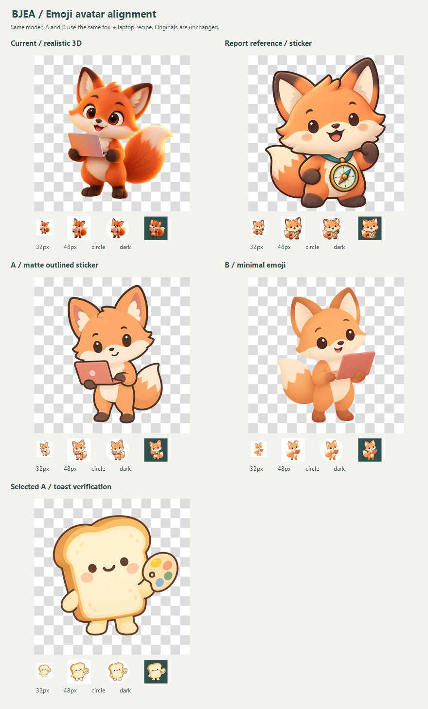

# 头像画风对齐：从写实 3D 回到 emoji

日期：2026-10-12。先对照现有画风与两种新提示词；用户随后选择了 **A：哑光描边贴纸**，正式生图提示词已采用 A 的约束。暂停的示例头像批量任务没有恢复，数据库中的旧头像没有替换。

## 发现

当前提示词里的 `3D clay-like illustration`、`soft lighting` 和“polished”容易让同一模型画出细毛、光泽、复杂眼睛与更强的立体感。报告样张的关键约束是**哑光 2.5D、暖色粗轮廓、点眼、小嘴、少量平滑色块，以及明确排除写实纹理**。透明背景本身没有失效：当前狐狸和两张新图的画布角落 alpha 都为 0；原图查看器显示的黑色并非烘焙背景，棋盘格对照可确认。

## 方法与结果

使用与网站相同的 `openai/gpt-image-2.5-sunburst`、Images API、`medium`、1:1、透明背景；两次新请求都固定为“杏色小狐狸拿一台珊瑚色小电脑”，只改风格约束。没有发送真实校友资料。精确提示词见两份 `*.request.json`，响应耗时、费用和图片哈希见 `*.result.json`。

| 对照 | 观察 | 32px/圆形裁切 | 实测费用 |
|---|---|---|---:|
| 当前头像 | 狐狸毛发、反光和大眼更接近动画电影角色 | 能认，但细节在缩小后变杂 | 既有资产，本轮未请求 |
| [报告样张](./00-report-fox.png) | 暖色轮廓、哑光与点眼形成统一的贴纸感 | 很清楚；原样张有 1.49% 的主体像素落在圆外 | 既有资产，本轮未请求 |
| [A：哑光描边贴纸](./01-report-style.png) | 最接近报告的视觉语言；消除了写实毛发和高光 | 轮廓清楚，电脑仍能辨认；主体像素均在圆内 | $0.014395 |
| [B：极简 emoji](./02-simple-emoji.png) | 更轻、更柔和；无描边使角色在浅底上对比偏弱 | 识别尚可，边缘在 32px 较软；主体像素均在圆内 | $0.014310 |

两次新生成均返回 1024×1024 RGBA PNG，合计 $0.028705；没有自动重试。`image-metrics.json` 保存透明度、主体边界和圆形裁切数据。

## 选择与跨主体复验

用户选择 **A**，理由是缩小后更清楚。网站提示词现在使用哑光 2.5D、暖色描边、点眼、小嘴与平滑色块，并明确排除写实纹理、强光和背景光晕；角色卡色调映射为具体颜色，避免 `sunset` 等词被画成场景。

随后以[小吐司＋调色盘](./03-other-subject.png)调用正式提示词复验一次：1024×1024 RGBA PNG，15.285 秒，$0.014625。主体及配件在 32px 仍清楚，alpha≥128 的主体像素均落在圆形裁切内。精确请求见 `03-other-subject.request.json`；这是第二类主体的一次样本，不能保证所有主体都稳定一致。
